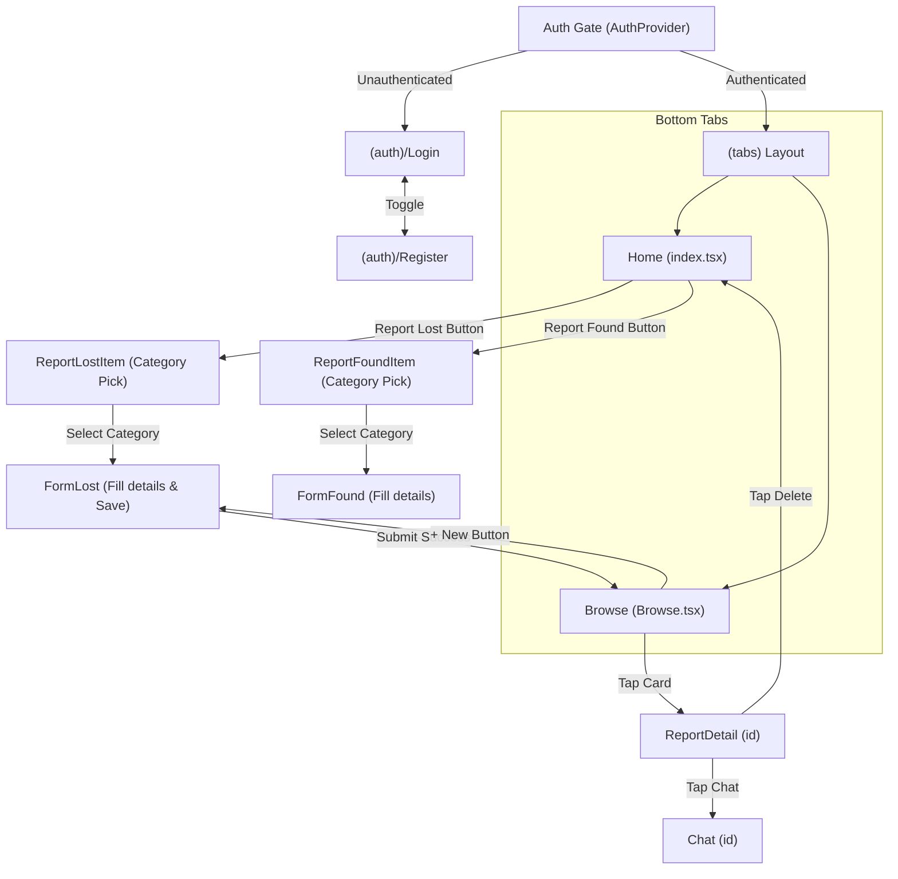

# Application Screen Inventory & UI/UX Audit

This document catalogues all current screens, components, user flows, and UX architecture in **Moobile_Project** to guide the upcoming UI/UX redesign.

---

## 1. Screen Inventory Matrix

| Screen Name | File Path | Route | Current Purpose | Status |
| :--- | :--- | :--- | :--- | :--- |
| **Login** | [`app/(auth)/Login.tsx`](file:///c:/Stuff/projects/Moobile_Project/app/(auth)/Login.tsx) | `/(auth)/Login` | Email & password user authentication | Active |
| **Register** | [`app/(auth)/Register.tsx`](file:///c:/Stuff/projects/Moobile_Project/app/(auth)/Register.tsx) | `/(auth)/Register` | Account registration (Email or Egyptian Phone +20) | Active |
| **Home (Dashboard)** | [`app/(tabs)/index.tsx`](file:///c:/Stuff/projects/Moobile_Project/app/(tabs)/index.tsx) | `/(tabs)` | Landing feed, quick report CTAs, "How It Works" guide | Active |
| **Browse / Feed** | [`app/(tabs)/Browse.tsx`](file:///c:/Stuff/projects/Moobile_Project/app/(tabs)/Browse.tsx) | `/(tabs)/Browse` | Search, filter by category, item feed list | Active |
| **Report Lost (Category)** | [`app/ReportLostItem.tsx`](file:///c:/Stuff/projects/Moobile_Project/app/ReportLostItem.tsx) | `/ReportLostItem` | Category selection step for lost items | Active |
| **Form: Report Lost** | [`app/FormLost.tsx`](file:///c:/Stuff/projects/Moobile_Project/app/FormLost.tsx) | `/FormLost` | Detailed form to report lost item (images, notes, contact) | Active |
| **Report Found (Category)** | [`app/ReportFoundItem.tsx`](file:///c:/Stuff/projects/Moobile_Project/app/ReportFoundItem.tsx) | `/ReportFoundItem` | Category selection step for found items | Active |
| **Form: Report Found** | [`app/FormFound.tsx`](file:///c:/Stuff/projects/Moobile_Project/app/FormFound.tsx) | `/FormFound` | Form to report found item (photo, contact details) | Active (Partial) |
| **Report Detail** | [`app/ReportDetail.tsx`](file:///c:/Stuff/projects/Moobile_Project/app/ReportDetail.tsx) | `/ReportDetail` | Detailed view of a report, action buttons (Chat, Delete, Call) | Active |
| **Chat** | [`app/Chat.tsx`](file:///c:/Stuff/projects/Moobile_Project/app/Chat.tsx) | `/Chat` | Demo 1-to-1 chat between finder and seeker | Active (Mock) |

---

## 2. Navigation Architecture & User Flows

---

## 3. Detailed Screen Breakdown & UX Review

### 3.1 Authentication: Login (`app/(auth)/Login.tsx`)
- **Key Elements**:
  - Banner image (`image.lost2`).
  - Welcome text: *"Welcome back, Login to continue"*.
  - Inputs: Email address, Password (`secureTextEntry`).
  - Primary Action: `Login` button (calls `login(email, password)` via `useAuth`).
  - Secondary Action: *"Don’t have an account? Register"* link.
- **UX & Design Audit**:
  - ⚠️ **Missing recovery flow**: No *"Forgot Password?"* link.
  - ⚠️ **Static layout**: Banner image takes up 160px height; on smaller devices with keyboard open, the login button or register link can be pushed off-screen.
  - 💡 **Redesign Opportunity**: Modern glassmorphic or clean card presentation with university branding, password visibility toggle icon (eye icon), and social / university SSO buttons if planned.

---

### 3.2 Authentication: Register (`app/(auth)/Register.tsx`)
- **Key Elements**:
  - Banner image (`image.lost2`).
  - Title: *"Create account / Use email or Egyptian phone number"*.
  - Dual-mode identifier input (`isEmail` or `isEgyptianPhone` regex: `+20\d{10}`).
  - Password input.
  - Primary Action: `Register` button.
  - Secondary Action: *"Already have an account? Login"* link.
- **UX & Design Audit**:
  - ⚠️ **No Name / Profile info**: User registers without a name, so reports must ask for contact name repeatedly.
  - ⚠️ **Strict regex without helper**: Egyptian phone format requires `+20...` prefix without inline prefix helper or auto-formatting.
  - 💡 **Redesign Opportunity**: Add Full Name input, split phone/email with tabs or country code dropdown (+20 preset), password strength indicator, and terms acceptance checkbox.

---

### 3.3 Tab 1: Home Dashboard (`app/(tabs)/index.tsx`)
- **Key Elements**:
  - Header: *"Welcome back / Home"* + Logout button with alert confirmation.
  - Hero image (`image.hero`).
  - Primary CTAs (Split 2-column cards):
    - 🟠 **Report Lost** (`bg-orange-600`) -> navigates to `/ReportLostItem`.
    - 🟢 **Report Found** (`bg-green-600`) -> navigates to `/ReportFoundItem`.
  - Content Section: *"How It Works"* with 3 custom cards (`1. Report Your Item`, `2. Help Others`, `3. Verify & Recover`).
- **UX & Design Audit**:
  - ⚠️ **No active activity / feeds on Home**: The home screen only has static information and buttons; it doesn't show recent lost items, user stats, or quick search.
  - ⚠️ **Hero image space**: Hero image consumes high visual weight without driving user action.
  - 💡 **Redesign Opportunity**: Convert into a dynamic dashboard featuring:
    - Quick search bar right at the top.
    - Floating action button (FAB) or prominent action cards.
    - Horizontal carousel of *"Recent Lost Items near you"*.
    - *"My Active Reports"* summary cards.

---

### 3.4 Tab 2: Browse & Feed (`app/(tabs)/Browse.tsx`)
- **Key Elements**:
  - Header: *"All Items / Browse lost & found items"* + `+ New` button.
  - Search Input: Real-time search query filtering title, description, location, and contact name.
  - Filter Chips (Horizontal Scroll): `All`, `Devices`, `Money`, `IDs`, `Other` (with active state toggle).
  - Item Cards:
    - Thumbnail image (or fallback image icon placeholder).
    - Item title, truncated description/location.
    - Reporter name, phone, and relative date.
    - Category tag pill badge (`DEVICE`, `MONEY`, `ID`, `OTHER`).
  - Empty state with icon and `Create Report` button.
- **UX & Design Audit**:
  - ⚠️ **Search bar styling bug**: Has `bg-red-100` background applied inline (`className="bg-red-100"`).
  - ⚠️ **Lost vs. Found distinction**: The list does not visually distinguish between an item that is **Lost** vs an item that was **Found** (no status badge).
  - ⚠️ **Privacy exposure**: Reporter phone number is directly printed on every card in the public feed.
  - 💡 **Redesign Opportunity**:
    - Add segmented control: **All** | **Lost** | **Found**.
    - Replace raw phone number with quick "Chat" or "Contact" action button.
    - Card layout enhancement: Modern card with rounded corners, elevated shadow, status badge (e.g. green "Found", red "Lost", grey "Resolved").
    - Pull-to-refresh & skeleton loading animation.

---

### 3.5 Category Selection Screens
#### A. Report Lost Category (`app/ReportLostItem.tsx`)
#### B. Report Found Category (`app/ReportFoundItem.tsx`)
- **Key Elements**:
  - Screen title: *"Select the category that best matches what you lost/found"*.
  - Category list using `CategoryType` component:
    - Devices (mobile icon)
    - Wallets (wallet icon)
    - IDs (credit card icon)
    - Other (add-to-list icon)
  - Helpful Tip box (Lost screen only).
- **UX & Design Audit**:
  - ⚠️ **Redundant extra screen**: Users must click a category screen that does not pass the chosen category param forward to `FormLost` or `FormFound`!
  - ⚠️ **Code duplication**: Two separate screens doing almost the exact same thing.
  - 💡 **Redesign Opportunity**:
    - Combine category selection directly into the report form as a visual chip picker or radio tile group at the top of the form, saving 1 full transition step.

---

### 3.6 Forms: Create Report
#### A. Form Lost (`app/FormLost.tsx`)
- **Key Elements**:
  - Image picker with choice of **Camera** or **Photo Library** (`expo-image-picker`).
  - Text fields: Item Name, Location Lost, Date, Note / Description, Contact Name, Contact Phone.
  - Validation: requires name, location, contact name, and valid phone.
  - Saves locally to `AsyncStorage` under `@lost_reports_v1`.
- **UX & Design Audit**:
  - ⚠️ **Date entry is plain text**: Users type dates manually rather than using a date picker modal.
  - ⚠️ **Form length**: Scrollable single long form; could benefit from progress indicator or structured sections (Item Info ➔ Location & Time ➔ Contact Details).

#### B. Form Found (`app/FormFound.tsx`)
- **Key Elements**:
  - Contact Name, Phone, and Image upload.
  - Static header *"Report — I found a device"*.
- **UX & Design Audit**:
  - ⚠️ **Missing fields**: Doesn't have item title, location found, category, or date fields.
  - ⚠️ **Does not persist**: Submitting only shows an `Alert.alert("Submitted")` without saving to `AsyncStorage`.
  - 💡 **Redesign Opportunity**: Unify into a single, smart **Report Form** with a top switch: `[ I Lost Something ]` vs `[ I Found Something ]`.

---

### 3.7 Item Details (`app/ReportDetail.tsx`)
- **Key Elements**:
  - Hero image banner (height 288px) with floating back and delete buttons.
  - Bottom sheet card layout (`rounded-t-3xl -mt-6`).
  - Item Title, Category badge, Description, Location, and Contact information.
  - Action footer buttons:
    - **Chat** (navigates to `/Chat?id=...`).
    - **Contact Owner** (triggers phone call prompt).
- **UX & Design Audit**:
  - ⚠️ **Delete permission**: Anyone viewing the item can tap "Delete" and remove it from storage (no owner verification check).
  - ⚠️ **Safe Handover missing**: As noted in `project.md`, detail screen should emphasize a safe campus handover location.
  - 💡 **Redesign Opportunity**:
    - Interactive map preview of the lost/found location.
    - Owner controls (Edit / Mark as Returned) vs Visitor controls (Claim / Send Message).
    - Status pill (`Open`, `Claimed`, `Resolved`).

---

### 3.8 Chat (`app/Chat.tsx`)
- **Key Elements**:
  - Header: Back button + Chat title.
  - Message bubble list (`FlatList` with timestamp and sender styling).
  - Simulated reply mechanism (700ms delayed mock response).
  - Floating message bar with `TextInput` and `Send` button.
- **UX & Design Audit**:
  - ⚠️ **Mock only**: Messages are not persisted in storage.
  - 💡 **Redesign Opportunity**:
    - Item snapshot banner pinned to the top of the chat (showing thumbnail, title, and "Safe Handover Spot: Campus Security Desk").
    - "Verify Ownership" challenge prompt button.
    - Quick reply tags (e.g. *"Is this still available?"*, *"Where can we meet?"*).

---

## 4. Gap Analysis: Current Code vs. Product Spec (`project.md`)

| Planned Feature in `project.md` | Currently Implemented? | Notes for UI/UX Phase |
| :--- | :---: | :--- |
| **4 Tab Navigation** (`Home`, `Report`, `Matches`, `Profile`) | ❌ Partial (Only `Home` & `Browse`) | Need to add **Profile** and **Matches** tabs, with centered **+ Report** action. |
| **Lost vs. Found item distinction** | ❌ No | Cards need colored status tags (e.g. Red for Lost, Emerald for Found). |
| **Suggested Matches screen** | ❌ Missing | Needs automated side-by-side matching UI with match percentages. |
| **Profile & My Reports management** | ❌ Missing | User currently has no screen to view their own active reports or logout easily. |
| **Campus Handover Location picker** | ❌ Missing | Location should support standard campus spots (e.g., Library Desk, Hall A, Security Office). |
| **Ownership Verification Question** | ❌ Missing | Finder can prompt seeker with a secret question (e.g. *"What is the phone wallpaper?"*). |

---

## 5. UI/UX Redesign Roadmap & Recommendations

1. **Design System & Visual Tokens**:
   - Primary Brand Color: Indigo / Sapphire Blue (`#2563EB` or `#1D4ED8`) or Teal (`#0CA5A0`).
   - Status Colors: Emerald (`Found / Returned`), Amber/Orange (`Lost / Pending`), Slate (`Archived`).
   - Typography: Clean sans-serif hierarchy (Inter or system font), using high contrast text (`text-slate-900` / `text-slate-500`).
2. **Bottom Navigation Overhaul**:
   - **Home** (Activity, search, recent feeds).
   - **Browse** (Full filterable list with segmented Lost / Found filter).
   - **+ Report** (Central elevated hero button).
   - **Matches** (AI/Keyword matches between lost and found items).
   - **Profile** (My listings, notification settings, student ID verification, logout).
3. **Consolidate Form Flow**:
   - Merge `ReportLostItem` + `FormLost` and `ReportFoundItem` + `FormFound` into one cohesive stepped modal or unified form.
